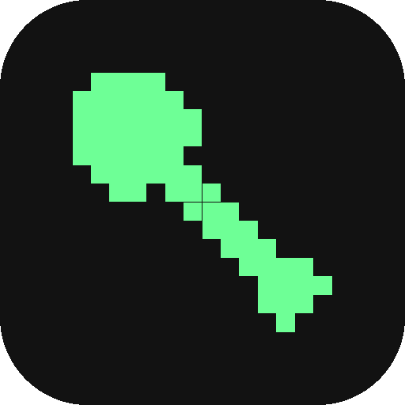
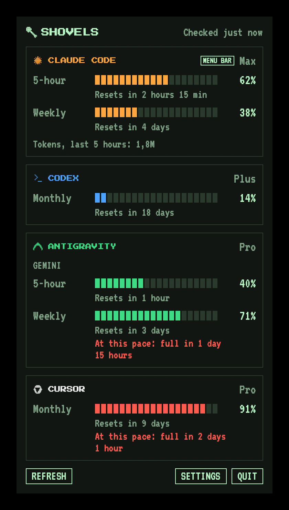

<p align="center">
  
</p>

<h1 align="center">Shovels</h1>

<p align="center">
  A macOS menu bar app that shows your usage limits for Claude Code, Codex, Antigravity and Cursor.
</p>

<p align="center">
  
  
</p>

<p align="center">
  
</p>

---

## What is Shovels?

Shovels runs each tool's own command line program in the background, reads the usage it reports, and shows the limits as bars with reset countdowns in a retro CRT-style dashboard. It warns you when a limit gets close and estimates when you will run out at your current pace.

## Features

- One card per provider, with each limit window, its percentage, a reset countdown and the plan.
- The menu bar shows one provider's glyph and percentage. You choose which one.
- Alerts at 80% and 95%, and when a nearly full window resets.
- Runway: "At this pace: full in …" when a window would fill before it resets.
- Show or hide providers, open at login, and a test alert, all in Settings.

## Requirements

- macOS 14 or later.
- The CLI for each provider you want to track, installed and signed in: `claude`, `codex`, `agy` (Antigravity) or `agent` (Cursor).

## Installation

1. Download `Shovels-1.0.0.zip` from the [Releases](../../releases) page and unzip it.
2. Move **Shovels.app** into your Applications folder.
3. Launch Shovels. It appears in the menu bar and has no Dock icon.

Shovels is not notarized, so macOS blocks the first launch. Right-click the app and choose **Open**, or run:

```bash
xattr -dr com.apple.quarantine /Applications/Shovels.app
```

## Setting up providers

- **Claude Code and Codex:** sign in with `claude` or `codex` in Terminal. Shovels then reads them automatically.
- **Antigravity and Cursor:** trust a workspace folder once in Terminal. The steps are in the guide for [Antigravity](docs/GUIDE.md#setting-up-antigravity) and [Cursor](docs/GUIDE.md#setting-up-cursor).

## Privacy

- Shovels makes no network calls of its own. The CLIs contact their own services with your existing logins.
- It never reads or stores login tokens.
- Usage history stays on your Mac, in `~/Library/Application Support/Shovels/history.json`, and is kept for 24 hours.

## Build from source

```bash
xcodebuild -project Shovels.xcodeproj -scheme Shovels -configuration Release \
  -derivedDataPath build CODE_SIGNING_ALLOWED=NO build
open build/Build/Products/Release/Shovels.app
```

## Documentation

The [guide](docs/GUIDE.md) covers how each provider is read, alerts and runway, troubleshooting, limitations and uninstalling.

## Contributing

Contributions are welcome. Open an issue to discuss a change, then submit a pull request.

## License

MIT. See [LICENSE](LICENSE).

VT323 and Press Start 2P are bundled under the SIL Open Font License; see [licenses/](licenses/). The provider marks are original pixel drawings, not official logos.

---

<p align="center">Made by Tomas Latyn</p>
